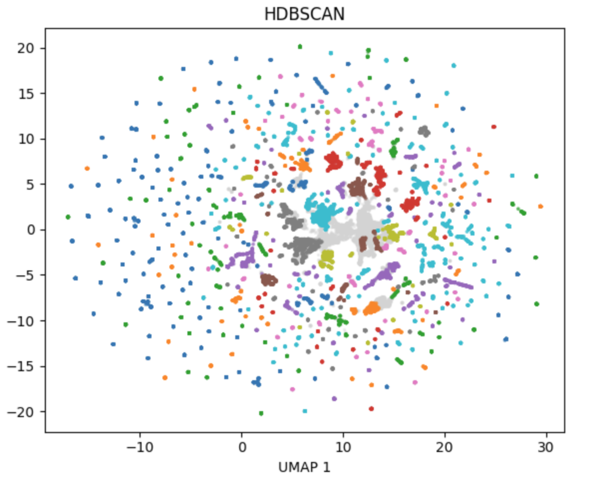

# ChainSense

> Behavioral segmentation of Ethereum wallets — discovering archetypes from on-chain activity alone.



[Live dashboard](https://chainsense-eth.vercel.app)

## Overview

ChainSense clusters ~6.3M active Ethereum wallets into behavioral archetypes using only on-chain activity — no address labels or token lists. Each wallet is reduced to a 26-dimensional feature vector (volume, timing, counterparty, and method-call patterns), clustered with HDBSCAN into ~18 clusters grouped into 7 archetype families, and served through a dashboard that classifies wallets in real time.

## Key finding

A ~159K-wallet family surfaced purely from behavior — near-total volume asymmetry, few counterparties, minimal token diversity — turned out to be phishing-victim drain wallets. The segmentation isolated them with no prior labeling; the pattern was confirmed afterward against Etherscan. This is the headline result and the focus of the dashboard's anomaly view.

## Pipeline

BigQuery (Ethereum public dataset) → bronze → silver → gold → HDBSCAN → XGBoost → FastAPI + DuckDB → React dashboard

- **ETL** — DuckDB consolidates the raw sharded export into a partitioned medallion layout (bronze → silver).
- **Features** — one standardized 26-dimensional vector per wallet (the gold layer).
- **Clustering** — HDBSCAN (RAPIDS cuML, A100) over the full population; UMAP for 2D projection.
- **Classification** — XGBoost assigns new or unclustered wallets to the nearest archetype.
- **Serving** — FastAPI queries the feature and label Parquet via DuckDB; an SSE feed streams live Alchemy blocks and classifies senders as they appear.

## Notebooks

| Notebook | Contents |
| --- | --- |
| `01_exploration` | Raw BigQuery schema and bronze → silver ETL |
| `02_features` | Gold feature layer and standardization |
| `03_model` | HDBSCAN clustering and XGBoost classifier (Colab / A100) |
| `04_analyst` | Smart-money labeling and activity aggregation |

## Project structure

```
backend/     FastAPI + DuckDB API, live SSE producer
web/         React + Vite + TypeScript dashboard
notebooks/   pipeline, from raw data to model
data/        medallion Parquet layers (gitignored)
scripts/     frontend data builders
```

## Running locally

```bash
# backend — FastAPI + DuckDB
pip install -r requirements.txt
export ALCHEMY_KEY=...            # required for the live feed
uvicorn backend.app:app --port 8000

# frontend — React + Vite (proxies /api → :8000)
cd web && npm install && npm run dev
```

## Stack

Python · DuckDB · pandas · HDBSCAN · UMAP · XGBoost · FastAPI · React · Vite · TypeScript · Tailwind · Alchemy
